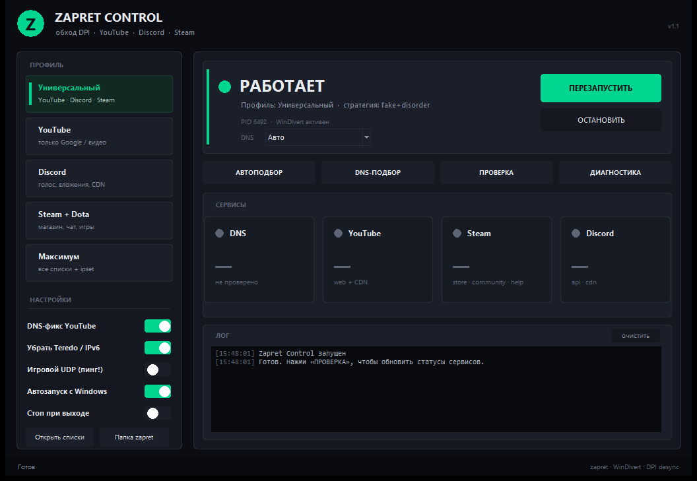

# Zapret Control

Нормальный GUI для zapret на Windows: YouTube, Discord, Steam без терминала и без Python.




## Скачать

**Готовая сборка (Python не нужен):**

[Zapret-Control-Windows.zip](https://github.com/Evinthelost/zapret-gui-/releases/latest/download/Zapret-Control-Windows.zip)

Зеркало в репозитории: [release/Zapret-Control-Windows.zip](release/Zapret-Control-Windows.zip)

Либо: `Code` → `Download ZIP`, внутри архива открой `release/Zapret-Control-Windows.zip`.

## Быстрый старт

1. Распакуй папку `ZapretControl` в путь без русских букв, например `C:\ZapretControl`.
2. Запусти `ZapretControl.exe` и подтверди UAC.
3. Первый запуск может занять до минуты: программа сама подбирает стратегию и DNS.
4. Нажми **ПРОВЕРКА** — все 8 пунктов должны быть `OK`.

Python, pip и зависимости для запуска **не нужны**. Всё собрано в EXE.

## Что умеет

- **АВТОПОДБОР** — перебирает 7 стратегий обхода DPI (`hostfakesplit`, `fake+multisplit`, `multidisorder` и др.) и выбирает ту, с которой работают YouTube, Steam и Discord.
- **DNS-ПОДБОР** — проверяет Quad9, Cloudflare, Google и Yandex и ставит тот, с которым резолвятся YouTube, Steam и Discord. VK/Mail.ru, SafeDNS и AdGuard в список больше не входят.
- **ПРОВЕРКА** — DNS, YouTube, YouTube CDN, Steam Store, Steam Community, Steam Help, Discord, Discord CDN.
- Профили: Универсальный, YouTube, Discord, Steam + Dota, Максимум.
- Тумблеры: DNS-фикс, Teredo/IPv6, игровой UDP, автозапуск, стоп при выходе.
- Автоматически останавливает старую службу `zapret`, чтобы не было конфликта.
- Тёмный интерфейс, лог, диагностика, открытие списков.

## DNS

При первом запуске и по кнопке **DNS-ПОДБОР** проверяются:

| DNS | Адреса |
|---|---|
| Quad9 | `9.9.9.9`, `149.112.112.112` |
| Cloudflare | `1.1.1.1`, `1.0.0.1` |
| Google | `8.8.8.8`, `8.8.4.4` |
| Yandex | `77.88.8.8`, `77.88.8.1` |

Выбирается первый, который отдаёт нормальные адреса YouTube/Steam/Discord и проходит проверку связи. Исходный DNS сохраняется в `utils/gui-dns-backup.json`; тумблер **DNS-фикс** возвращает всё как было.

DNS можно выбрать вручную в селекторе статус-карточки: **Авто / Quad9 / Cloudflare / Google / Yandex / Системный (сброс)**.

## Dota

По умолчанию игровой UDP не трогается, чтобы не портить пинг. Если Dota лагает:

1. Выключи Radmin VPN и другие VPN.
2. Выбери профиль **Steam + Dota**.
3. Если не помогло — включи **Игровой UDP (пинг!)** и перезапусти движок.

## Сборка из исходников

```bat
python -m pip install -r requirements-build.txt
python -m PyInstaller --noconfirm --clean --onedir --windowed ^
  --name ZapretControl --icon build_assets\zapret.ico ^
  --distpath build_dist --workpath build_work --specpath build_spec ^
  zapret_gui.py
```

Затем положи рядом с `ZapretControl.exe` папки `bin` и `lists` из этого репозитория.

## Важно

- EXE без цифровой подписи. SmartScreen может предупредить: **Подробнее → Выполнить в любом случае**.
- Нужны права администратора: WinDivert работает на уровне драйвера.
- Программа меняет системный DNS и отключает Teredo/ISATAP/6to4. Оба действия обратимы тумблерами.
- Старые `general*.bat` и `service.bat` не входят в сборку. Не запускай их вместе с GUI.
- Автозапуск создаёт задачу планировщика `ZapretControlPy`.

## Компоненты и лицензии

См. [NOTICE.md](NOTICE.md). В сборку входят `winws.exe` и списки из проекта zapret, а также WinDivert. У них свои лицензии; GUI-код — MIT.

